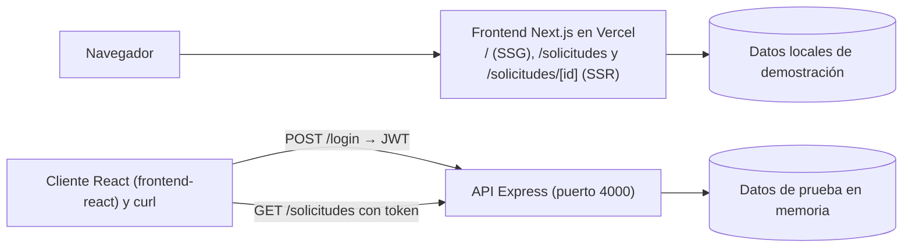

# README — Plataforma de Gestión de Solicitudes Académicas (PA4)

> **Curso:** PROGRAMACION WEB - II  
> **Código:** 30690  
> **Evaluación:** PA4 — Proceso de Aprendizaje 4  
> **Periodo / corte:** 202620 · Sesión 13  
> **Equipo:** Grupo 7  


## 1. Integrantes

| Integrante | Rol | Participación |
|---|---|---|
| Leonardo Alonso Guillén Zúñiga | Backend Node.js (apoyo a la Actividad 1) | API Express con login JWT, ruta `/solicitudes` protegida con token y datos de prueba (`backend/`). Las pruebas del backend (login y rutas protegidas, con capturas) las ejecutó Mariano Guerrero Barrueto y están en [`docs/pruebas-backend.md`](docs/pruebas-backend.md). |
| Mariano Guerrero Barrueto | Actividad 4: preparación para producción; Actividad 1, parte 2: cliente React (reasignada); integración del repositorio | Estructura del repositorio, README y documentación; ajustes a la API (ruta `GET /solicitudes/:id`, datos del usuario en el login y puerto 4000). Preparación para producción: variables de entorno, script `start`, logs y `/health` en el backend, build con Webpack documentado en `docs/produccion.md`. Cliente React en `frontend-react/` (login con JWT, lista, detalle y manejo de errores), documentado en [`docs/cliente-react.md`](docs/cliente-react.md). |
| Santiago Javier Prado Carrasco | Actividad 2: Next.js (SSR, SSG y ruta dinámica) | Proyecto `frontend-next` con Pages Router: `/` con SSG, `/solicitudes` y `/solicitudes/[id]` con SSR y página 404. Documentación en `docs/actividad-2-nextjs.md`. Los resultados y la nota sobre Webpack de ese documento los completó Mariano Guerrero Barrueto, con las capturas de la Actividad 3 y una verificación local. |
| Mariano Ramón Valderrama Shuña | Actividad 3: despliegue del frontend en Vercel | Despliegue del proyecto `frontend-next` en Vercel y verificación de sus rutas. URL: https://proceso-aprendizaje-4.vercel.app/ |

### Reparto de actividades

| # | Actividad | Responsable |
|---|---|---|
| 1 | Backend Node.js: API con login JWT y `/solicitudes` (apoyo a la Actividad 1) | Leonardo Alonso Guillén Zúñiga |
| 2 | Actividad 1 (parte 2): consumo de APIs y sesiones JWT en React | Mariano Guerrero Barrueto (reasignada) |
| 3 | Actividad 2: Next.js con SSR, SSG y rutas dinámicas | Santiago Javier Prado Carrasco |
| 4 | Actividad 3: despliegue del frontend en Vercel | Mariano Ramón Valderrama Shuña |
| 5 | Actividad 4: preparación para producción | Mariano Guerrero Barrueto |


## 2. Descripción y objetivo

**Descripción:**  
Plataforma de Gestión de Solicitudes Académicas, que viene de la PA3. En esta cuarta etapa se agrega una API en Node.js con autenticación JWT, un frontend con Next.js que usa SSR y SSG, su despliegue en Vercel y la preparación de la solución para producción.

**Objetivo:**  
Integrar el frontend con una API y sesiones JWT, optimizar la entrega con Next.js (SSR/SSG y rutas dinámicas), desplegarlo en Vercel y preparar la solución para producción.

**Alcance:**  
Sesiones 11 a 13. No incluye despliegue del backend en Render/MongoDB Atlas ni seguridad XSS/CSRF (sesiones 14 y 15).


## 3. Desarrollo

### Actividad 1: Consumo de APIs y sesiones JWT en React
**Backend (API Node.js):** servidor Express con `POST /login` (devuelve un JWT y los datos del usuario), `GET /solicitudes` y `GET /solicitudes/:id`, ambas protegidas con el token. Corre en el puerto 4000 por defecto. El contrato completo está en [`docs/api.md`](docs/api.md).

**Cliente React:** está en `frontend-react/` (React y Vite) y consume la API con `fetch`. La parte 2 de esta actividad se reasignó y la implementó Mariano Guerrero Barrueto.

- **Sesión:** el login (`POST /login`) devuelve el token y los datos del usuario, que se guardan en `sessionStorage`. Cada petición a `/solicitudes` envía el encabezado `Authorization: Bearer <token>`, y al recargar la página la sesión se recupera.
- **Pantallas:** login, lista de solicitudes con búsqueda por número y detalle de cada solicitud.
- **Errores:** credenciales incorrectas (401) se muestran en el formulario; un token vencido (401) devuelve al login con un aviso y borra la sesión; una solicitud inexistente (404) muestra el mensaje de la API; si la API no responde, se avisa y la lista ofrece reintentar.
- **Pruebas:** 9 pruebas automáticas (`npm test`) y una verificación contra la API real.

Detalle y justificación en [`docs/cliente-react.md`](docs/cliente-react.md).

### Actividad 2: Next.js con SSR, SSG y rutas dinámicas
El proyecto está en `frontend-next` y usa Pages Router.

- `/`: información general con SSG (`getStaticProps`), porque cambia poco y se puede preparar durante la compilación.
- `/solicitudes`: listado con SSR (`getServerSideProps`), porque es información que puede cambiar entre peticiones.
- `/solicitudes/[id]`: detalle con SSR y parámetro dinámico `id`. Si la solicitud no existe, devuelve `notFound` y muestra la página 404.

La demostración usa datos locales compatibles con el backend (`id`, `titulo` y `estado`); no consume la API ni autentica. Detalle y justificación en [`docs/actividad-2-nextjs.md`](docs/actividad-2-nextjs.md).

### Actividad 3: Despliegue en Vercel
**URL desplegada:** https://proceso-aprendizaje-4.vercel.app/

**Proceso:** se creó una cuenta en Vercel con GitHub, se hizo un fork del repositorio del grupo (porque pertenece a otra cuenta de GitHub),  se importó en Vercel y se eligió `frontend-next` como Root Directory, porque el proyecto de Next.js está en esa carpeta. Vercel detectó Next.js y usó `npm run build`. Antes de desplegar se ejecutó el build localmente para verificar que no tuviera errores.

**Variables de entorno:** ninguna, porque la demostración usa datos locales y no consume la API.

**Verificación de rutas:**
- `/`: carga la página de inicio. La hora no cambia al recargar (SSG).
- `/solicitudes`: muestra 2 solicitudes. La hora cambia al recargar (SSR).
- `/solicitudes/101`: muestra el detalle de la solicitud (ruta dinámica).
- `/solicitudes/999`: muestra la página 404.

Capturas en [`docs/evidencias/`](docs/evidencias/).

### Actividad 4: Preparación para producción
Se preparó el proyecto para producción sin cambiar su funcionamiento:

- **Build con Webpack:** `npm run build` en `frontend-next` ejecuta `next build --webpack` y genera código minificado. Next.js compila con SWC, sin configuración de Babel.
- **Variables de entorno:** el backend lee `JWT_SECRET`, `PORT`, `JWT_EXPIRES_IN` y `LOG_LEVEL` desde un `.env` fuera de Git. `.env.example` documenta cada variable sin valores reales.
- **Logs:** cada petición queda registrada con fecha, método, ruta, código y duración; los logins fallidos y los errores se registran aparte. No se guardan cuerpos, claves ni tokens.
- **Monitoreo:** endpoint `GET /health` para comprobar que el servicio está activo.
- **Scripts:** `npm start` y `npm run dev` en el backend.

Detalle, pruebas y limitaciones en [`docs/produccion.md`](docs/produccion.md).

### Decisiones técnicas
- **SSG en la página de inicio y SSR en las solicitudes:** el inicio es contenido estático, por lo que se genera una sola vez en el build; las solicitudes cambian según el dato pedido y se resuelven en cada petición.
- **Webpack forzado con `--webpack`:** Next.js 16 usa Turbopack por defecto. Se fijó Webpack en los scripts `dev` y `build` porque el enunciado lo pide y así el build es el mismo para todo el equipo.
- **Configuración con `dotenv` y `.env` en la raíz:** el secreto JWT ya no está en el código y el servidor no arranca si falta, para evitar un despliegue con una clave por defecto.
- **Logs propios y mínimos:** se evitó una librería nueva. Los logs no incluyen cuerpos ni encabezados, para no filtrar credenciales.


## 4. Solución propuesta

La solución tiene dos partes que hoy se ejecutan por separado:

- **Frontend (`frontend-next`):** aplicación Next.js (Pages Router) desplegada en Vercel. Muestra la información general (SSG), el listado de solicitudes y su detalle (SSR) y una página 404. En esta etapa usa datos locales y no consume la API.
- **API (`backend`):** servidor Express en el puerto 4000. `POST /login` valida usuario y clave y devuelve un JWT; `GET /solicitudes` y `GET /solicitudes/:id` exigen ese token. Su configuración (secreto, puerto, nivel de logs) viene de variables de entorno, registra cada petición y expone `GET /health`.



**Despliegue:** solo el frontend está desplegado (Vercel, con `frontend-next` como Root Directory y sin variables de entorno). El backend corre en local; su despliegue queda para la Evaluación Integral.

**Herramientas:** Node.js 22, Express 5, `jsonwebtoken`, `cors`, `dotenv`, Next.js 16 con React 19 (compilado con Webpack), cliente React con Vite y Vitest, Vercel, Git y GitHub.


## 5. Cómo ejecutar o revisar

```bash
git clone https://github.com/Marscience-74/proceso_aprendizaje_4.git
cd proceso_aprendizaje_4

# Variables de entorno (en la raíz del repositorio; define un JWT_SECRET propio)
cp .env.example .env

# API (puerto 4000)
cd backend
npm install
npm start

# Frontend Next.js (en otra terminal, puerto 3000)
cd frontend-next
npm install
npm run dev

# Cliente React (en otra terminal, puerto 5173; necesita la API en marcha)
cd frontend-react
npm install
npm run dev
```

**Requisitos:** Node.js (probado con la versión 22). Las variables de entorno previstas están en `.env.example`.

**Pasos de revisión:**
1. Abrir https://proceso-aprendizaje-4.vercel.app/ y verificar la página de Inicio; la hora de "Generada en" no cambia al recargar (SSG).
2. Abrir `/solicitudes`: muestra 2 solicitudes y la hora cambia en cada recarga (SSR).
3. Abrir `/solicitudes/101` (ruta dinámica) y `/solicitudes/999`, que muestra la página 404.
4. En local, con la API en marcha (`npm start`): `curl localhost:4000/health` devuelve `"estado":"ok"`.
5. Iniciar sesión con `POST /login` (usuario `admin`, clave `123`) y consultar `/solicitudes` con el token; sin token o con credenciales incorrectas responde 401. Los casos y sus resultados están en [`docs/pruebas-backend.md`](docs/pruebas-backend.md).
6. En `frontend-next`, ejecutar `npm run build` y verificar que termina sin errores y muestra `Next.js 16.4.6 (webpack)`.
7. Con la API en marcha, en `frontend-react` ejecutar `npm install` y `npm run dev`, abrir http://localhost:5173, iniciar sesión (`admin` / `123`), ver la lista, abrir un detalle y buscar el número 999 para ver el error 404.

> No se publican contraseñas, credenciales, tokens ni accesos de producción.


## 6. Evidencias

| Actividad | Evidencia |
|---|---|
| 1. Consumo de APIs y JWT | Pruebas del backend en `docs/evidencias/api-login.png` y `api-rutas-protegidas.png`, con el detalle en [`docs/pruebas-backend.md`](docs/pruebas-backend.md). Cliente React: capturas `react-login-error.png`, `react-lista.png` y `react-detalle-404.png` en `docs/evidencias/`, y pruebas en [`docs/cliente-react.md`](docs/cliente-react.md). |
| 2. Next.js SSR/SSG | Tabla de resultados en [`docs/actividad-2-nextjs.md`](docs/actividad-2-nextjs.md) y capturas `build-next.png`, `vercel-inicio.png`, `vercel-ssr-1.png`, `vercel-ssr-2.png`, `vercel-detalle.png` y `vercel-404.png` en `docs/evidencias/` |
| 3. Vercel | URL: https://proceso-aprendizaje-4.vercel.app/ · Capturas en `docs/evidencias/` (`vercel-*.png` y `build-next.png`) |
| 4. Producción | Build con Webpack, logs del backend y `/health` en `docs/evidencias/` (`build-webpack.png`, `backend-logs.png`, `health.png`); variables y pruebas en [`docs/produccion.md`](docs/produccion.md) |


## 7. Conclusiones

- **API y JWT:** se construyó una API Express donde el login devuelve un token firmado y un middleware lo verifica antes de entregar los datos, con errores 401 y 404 en un formato JSON uniforme. El cliente React inicia sesión con `fetch`, guarda la sesión en `sessionStorage`, envía el token en el encabezado `Authorization` y maneja los errores 401, 404 y la API caída.
- **Next.js (SSR/SSG):** se eligió SSG para la información general, que cambia poco, y SSR para el listado y el detalle, que se resuelven en cada petición.
- **Vercel y producción:** Se fijó Webpack en el build y se sacaron del código el secreto y el puerto del backend, con logs sin datos sensibles y un endpoint `/health`. 
- **Balance del equipo:** el trabajo se repartió por actividades (API, cliente React, Next.js, Vercel y producción) y se integró en un solo repositorio con ramas y pull requests con el fin de separar responsabilidades manteniendo una arquitectura mas ordenada y limpia


## 8. Video de exposición

**Video público de YouTube:** [PEGAR AQUÍ EL ENLACE]

Todos los integrantes participan con la cámara prendida y explican el problema, el procedimiento, la solución, las decisiones tomadas y su justificación.


## 9. Matriz de participación

| Integrante | Desarrollo | Pruebas | Documentación | Exposición | Evidencia de participación |
|---|---|---|---|---|---|
| Leonardo Alonso Guillén Zúñiga | API Express con login JWT, `/solicitudes` protegida y datos de prueba | Pruebas de su API ejecutadas por Mariano Guerrero Barrueto (`docs/pruebas-backend.md`) | Código de la API en `backend/`; el contrato lo documentó Mariano Guerrero Barrueto en `docs/api.md` | Explica la API: login con JWT, verificación del token y rutas protegidas | Commits "Inicializar proyecto" y "Servidor y mock data" |
| Mariano Guerrero Barrueto | Ajustes a la API; variables de entorno, logs y `/health`; documentación de producción; cliente React (`frontend-react/`) | Backend sin `.env` (no arranca), login correcto e incorrecto, rutas con y sin token, 404 y JSON inválido; `npm run build` con Webpack; 9 pruebas automáticas del cliente React y verificación contra la API real | README, `docs/api.md`, `docs/produccion.md`, `docs/pruebas-backend.md` y `docs/cliente-react.md` | Explica el cliente React (login con JWT, sesión, lista, detalle y errores), las variables de entorno, los logs, `/health`, el build con Webpack y cómo se integró el repositorio | Commits "Actualizando la Actividad 1", "Corrigiendo el repositorio", "Backend: variables de entorno, logs de peticiones y endpoint /health", "Documentar la Actividad 4: preparación para producción y evidencias", "Completar resultados de la Actividad 2 y corregir la nota sobre Webpack", "Documentar las pruebas del backend y actualizar el README" y "Agregar el cliente React (Actividad 1, parte 2)" |
| Santiago Javier Prado Carrasco | Proyecto Next.js con SSG, SSR y ruta dinámica | Resultados verificados por Mariano Guerrero Barrueto (build y prueba local) con capturas de Valderrama | `docs/actividad-2-nextjs.md` | Explica SSG frente a SSR, la ruta dinámica y la página 404 con `notFound` | Commit "Implementar Next.js con SSR SSG y detalle dinamico" (PR #2) |
| Mariano Ramón Valderrama Shuña | Despliegue de `frontend-next` en Vercel | Build local y verificación de `/`, `/solicitudes`, `/solicitudes/101`, la página 404 y el comportamiento SSG/SSR en producción | Sección Actividad 3 del README y capturas en `docs/evidencias/` | Explica el despliegue en Vercel (fork, Root Directory) y la verificación de rutas | Commit "Desplegar frontend en Vercel y documentar la Actividad 3" (PR #3) |

---

**Última actualización:** 23/11/2026