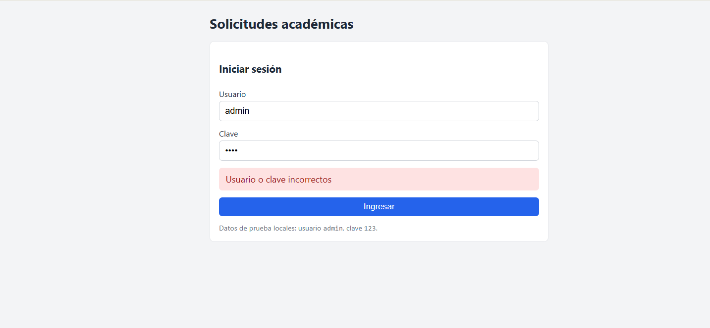
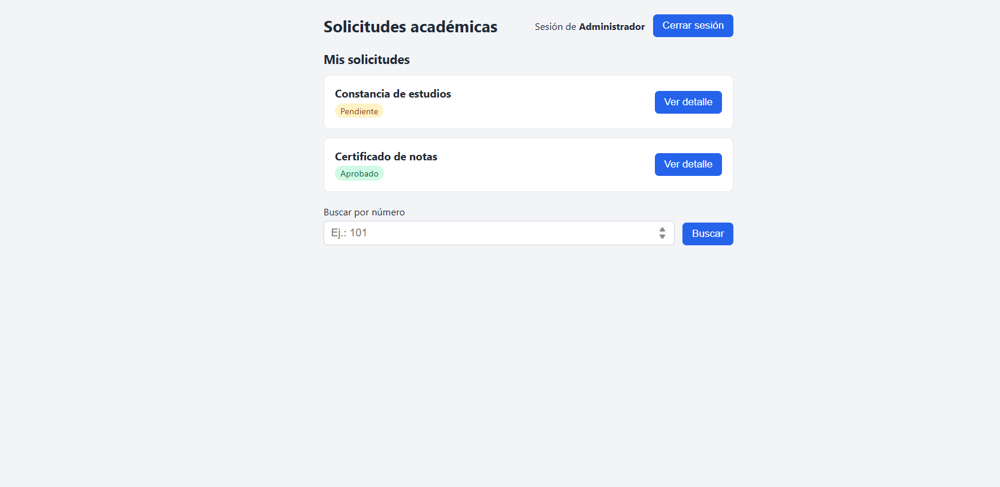
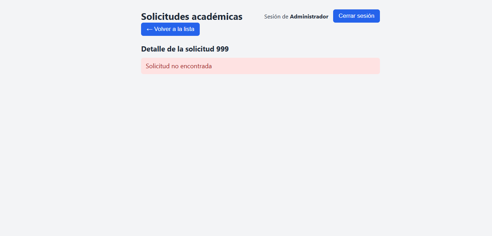

# Cliente React (Actividad 1, parte 2)

Cliente web en `frontend-react/` que consume la API de `backend/`: inicia sesión con JWT, lista las solicitudes, muestra su detalle y maneja los errores de la API. Lo implementó Mariano Guerrero Barrueto, porque esta parte, asignada a otro integrante, no se entregó. El contrato de la API está en [`api.md`](api.md).

## Cómo ejecutarlo

Con la API en marcha (`npm start` dentro de `backend/`, puerto 4000):

```bash
cd frontend-react
npm install
npm run dev
```

Se abre en `http://localhost:5173`. Usuario de prueba: `admin`, clave `123` (datos simulados locales).

La dirección de la API es `http://localhost:4000` por defecto. Para cambiarla se define `VITE_API_URL` en el `.env` de la raíz del repositorio (ver `.env.example`). Solo las variables con prefijo `VITE_` llegan al navegador: el `JWT_SECRET` de ese mismo archivo no se incluye en el build.

Otros comandos: `npm run build` genera el sitio en `dist/` y `npm test` ejecuta las pruebas.

## Estructura

| Archivo | Qué hace |
|---|---|
| `src/api.js` | Llamadas a la API con `fetch` (`login`, `getSolicitudes`, `getSolicitud`) y la clase `ApiError`, que lleva el código HTTP y el mensaje de la API. |
| `src/session.js` | Guarda, lee y borra la sesión (token y datos del usuario) en `sessionStorage`. |
| `src/App.jsx` | Decide qué se ve: login, lista o detalle. Inicia y cierra la sesión. |
| `src/components/LoginForm.jsx` | Formulario de login con mensaje de error y estado "Ingresando...". |
| `src/components/SolicitudesList.jsx` | Lista de solicitudes, botón de reintento y búsqueda por número. |
| `src/components/SolicitudDetalle.jsx` | Detalle de una solicitud. |
| `src/App.test.jsx` | Pruebas del flujo completo. |

## Cómo funciona la sesión

1. El usuario envía su usuario y clave con `POST /login`.
2. Si son correctos, la API devuelve un token JWT y los datos del usuario. El cliente los guarda en `sessionStorage`.
3. Cada petición a `/solicitudes` y `/solicitudes/:id` lleva el encabezado `Authorization: Bearer <token>`.
4. Al recargar la página, la sesión se recupera de `sessionStorage` y no hace falta volver a iniciar sesión. Al cerrar la pestaña o pulsar "Cerrar sesión", se borra.

## Manejo de errores

| Situación | Respuesta de la API | Qué ve el usuario |
|---|---|---|
| Usuario o clave incorrectos | 401 `Usuario o clave incorrectos` | El mensaje en el formulario; no se guarda sesión. |
| Token vencido o inválido en la lista o el detalle | 401 `Token inválido o expirado` | Vuelve al login con el aviso "Tu sesión expiró. Inicia sesión de nuevo." y se borra la sesión. |
| Solicitud que no existe | 404 `Solicitud no encontrada` | El mensaje en la pantalla de detalle, con el botón para volver. |
| La API no responde | Sin respuesta | "No se pudo conectar con la API. Verifica que esté en marcha." En la lista aparece un botón "Reintentar". |
| Cualquier otro error | Otro código | El mensaje de la API, o uno genérico si no trae. |

## Decisiones técnicas

- **`fetch` en lugar de Axios:** el navegador ya lo incluye, las llamadas son pocas y no se agrega una dependencia. El manejo de errores quedó centralizado en `request()`.
- **`sessionStorage` en lugar de `localStorage`:** la sesión dura solo mientras la pestaña esté abierta, lo que reduce el tiempo en que el token queda guardado. Aun así, cualquier script de la página podría leerlo; protegerlo ante XSS corresponde a las sesiones 14 y 15 y no se aborda aquí.
- **Sin librería de rutas:** hay solo tres pantallas y se controlan con estado. Una librería de rutas no aportaría nada a este tamaño.
- **Vite:** arranque rápido y configuración mínima para una aplicación React que no necesita renderizado en servidor.
- **La API no se modificó:** el cliente se adaptó al contrato existente. La API ya aceptaba peticiones desde otro origen (`cors()`); se comprobó que responde a la petición previa del navegador (preflight) para `Authorization` y `Content-Type`.

## Pruebas

`npm test` ejecuta 9 pruebas con `fetch` simulado, así que no necesitan la API en marcha:

1. Muestra el login al inicio.
2. Con credenciales correctas guarda la sesión, muestra la lista y envía el token en `Authorization`.
3. Con credenciales incorrectas muestra el error y no guarda sesión.
4. Si la API no responde, avisa que no se pudo conectar.
5. Abre el detalle de una solicitud.
6. Muestra el 404 cuando la solicitud no existe.
7. Si el token venció (401), vuelve al login con un aviso y borra la sesión.
8. Recupera la sesión guardada al recargar.
9. Cerrar sesión borra la sesión y vuelve al login.

Además, el 23/11/2026 se ejecutaron las funciones de `src/api.js` contra la API real. Resultados: login correcto (200), clave incorrecta (401), lista con token (200), lista sin token (401), lista con token inválido (401), detalle de 101 y 102 (200) y detalle de 999 (404). En la API quedaron registradas con esos mismos códigos.

## Evidencias

Login con credenciales incorrectas:



Lista de solicitudes con la sesión iniciada:



Búsqueda de una solicitud que no existe (404):



## Limitaciones

- Los datos son de prueba y la API corre solo en local; este cliente no está desplegado.
- No hay cierre de sesión automático por tiempo: la sesión termina cuando la API responde 401 a una petición.
