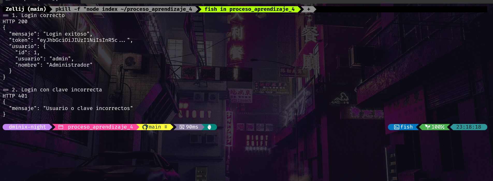

# Pruebas del backend (API Express con JWT)

Pruebas manuales de la API de `backend/` con `curl`, ejecutadas el 22/11/2026 por Mariano Guerrero Barrueto sobre la API desarrollada por Leonardo Alonso Guillén Zúñiga. El contrato de la API está en [`api.md`](api.md).

## Cómo repetirlas

Con el servidor en marcha (`npm start` dentro de `backend/`, puerto 4000):

```bash
# 1. Login correcto (devuelve el token)
curl -s -X POST localhost:4000/login -H 'Content-Type: application/json' -d '{"usuario":"admin","clave":"123"}'

# Guardar el token devuelto
TOKEN="<pegar aquí el token del login>"

# 4. Ruta protegida con token
curl -s localhost:4000/solicitudes -H "Authorization: Bearer $TOKEN"
```

Las demás pruebas cambian la ruta, los datos o el encabezado, como indica la tabla.

## Resultados

| # | Prueba | Esperado | Obtenido |
|---|---|---|---|
| 1 | `POST /login` con `admin` / `123` | 200 con `mensaje`, `token` y `usuario` | 200: "Login exitoso", token y datos del usuario |
| 2 | `POST /login` con una clave incorrecta | 401 | 401: "Usuario o clave incorrectos" |
| 3 | `GET /solicitudes` sin token | 401 | 401: "Acceso denegado: token no proporcionado" |
| 4 | `GET /solicitudes` con token | 200 con la lista | 200: solicitudes 101 y 102 |
| 5 | `GET /solicitudes/101` con token | 200 con la solicitud | 200: "Constancia de estudios", Pendiente |
| 6 | `GET /solicitudes/999` con token | 404 | 404: "Solicitud no encontrada" |
| 7 | `GET /solicitudes` con un token inválido | 401 | 401: "Token inválido o expirado" |

## Evidencias

Login correcto e incorrecto (pruebas 1 y 2). El token aparece recortado a propósito:



Rutas protegidas, detalle, no encontrado y token inválido (pruebas 3 a 7):


## Relacionado

- Logs de estas peticiones y endpoint `/health`: [`produccion.md`](produccion.md).
